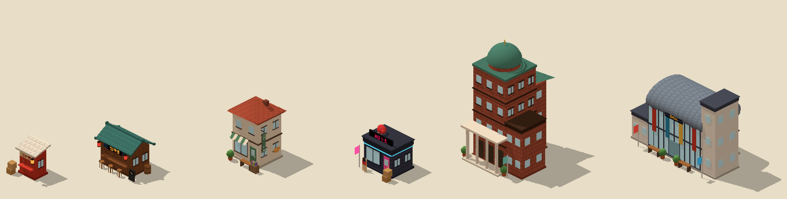
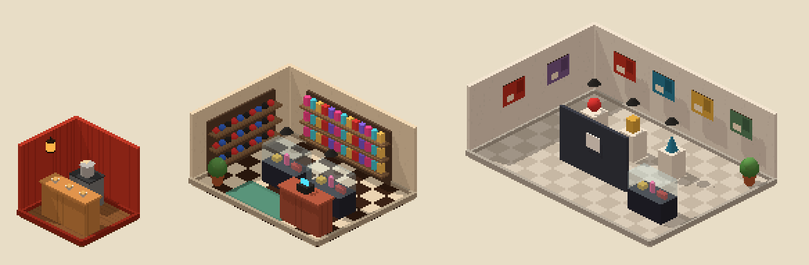
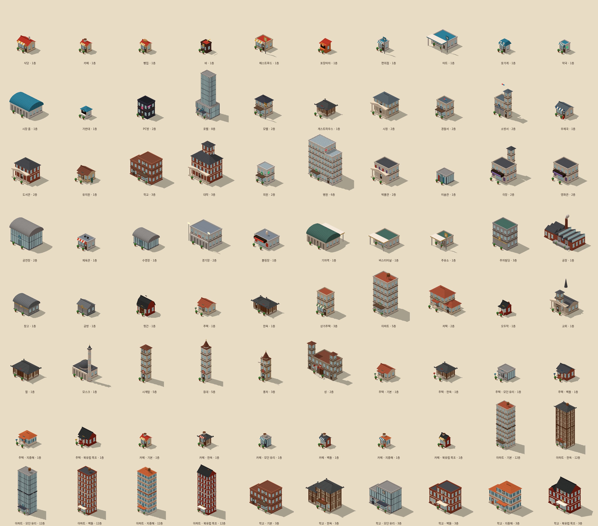
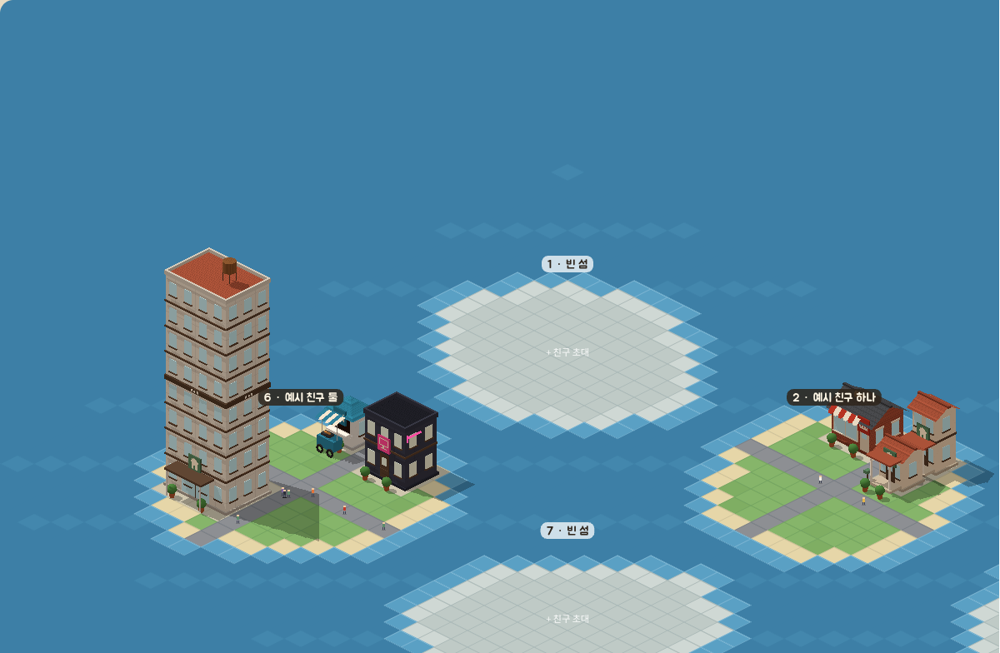
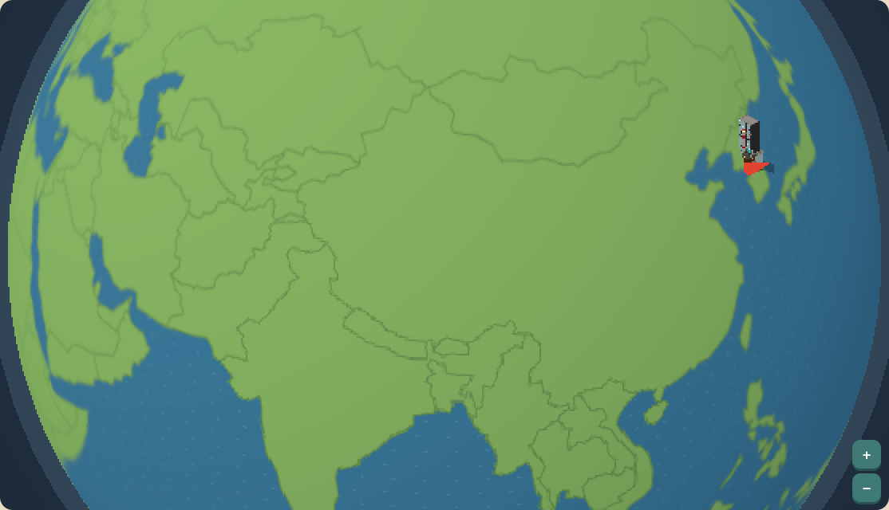
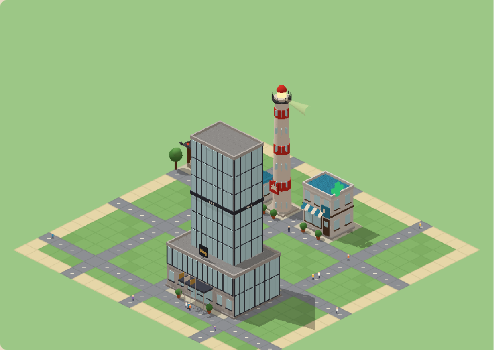
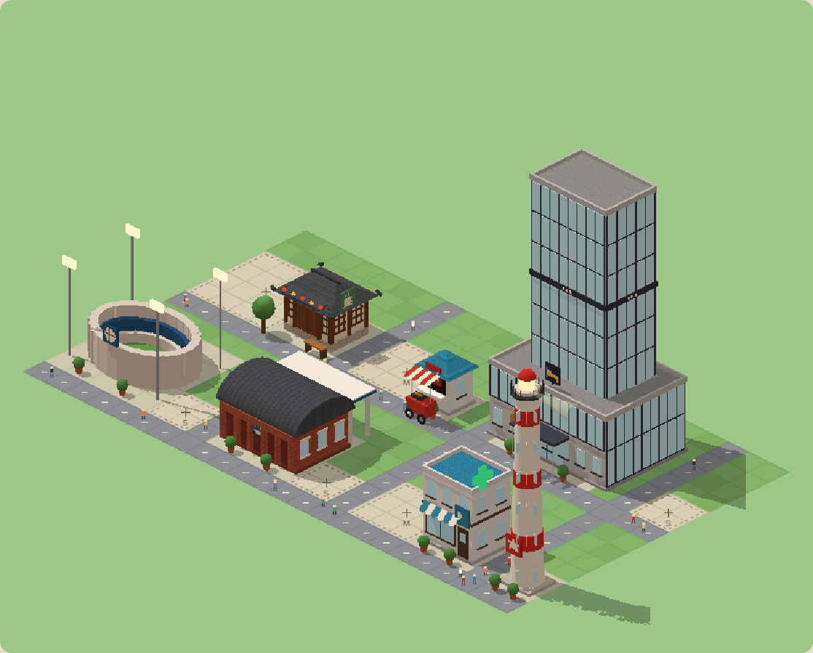

# promptshop

**One line of text → a shop spec (JSON) → a pixel-art isometric shop, outside and inside.**





Each building above came from one line, for example *“a wide exhibition hall showing the gloves and belts of past champions”* or *“a small fish-shaped-bread stall in a winter alley”*. The model chooses the size, the number of floors, wings, roof and front from the description.

## Why specs, not images

Image models draw a nice picture, but every picture comes out at a slightly different angle, scale and light. Put two of them side by side and the town looks wrong.

promptshop splits the work:

- **The LLM writes a spec**: roof type, wall material, colors, sign, props, furniture layout. This is short JSON, and language models are good at it.
- **The renderer owns the look**: an orthographic isometric camera (yaw 45°, pitch 30°, so floor tiles are exactly 2:1), one tile = 40 px wide, one fixed sun, hard shadows, nearest-neighbor textures.

The result is that every shop, from anyone, fits in the same town. Specs are also small, cheap to generate, easy to edit ("make the roof red" changes one field), and can carry game data. A spec that says four stools can also mean four seats.

The exterior and the interior come from one spec, so the inside inherits the outside's palette and materials and reads as the same shop.

## Run it

No build step. Serve the folder and open `index.html`:

```bash
python3 -m http.server 8000
# open http://localhost:8000/
```

The page renders the example shops and has a box where you can edit a spec and render it.

To export PNGs with headless Chrome:

```bash
scripts/render.sh            # writes out/<id>-ext.png and out/<id>-int.png
```

## Catalogue (spec v2, in progress)

`catalog.html` renders every building type in `src/v2/catalog.js` with its default look, then the same buildings in each style preset. Spec v2 lives in `src/v2/`: the model picks a type and a style, `normalize()` fills every default, and `buildExterior()` draws masses, roofs, facades, signs and props.



## Cross-sections

Inside, a building is a stack of floors drawn as an exploded cross-section. Each kind of floor is written once over a range of levels ("2-19: guest floors"), repeated floors merge into one plate with a ×N label, a lift core threads the floors, zones are laid out by a squarified treemap, and each zone brings its own furniture. `section.html` renders a few examples.


## Watch it build

`build.html` shows a shop being built while the model is still writing. The model answers in **JSON Lines, one part per line** (name → body → front → roof → sign → props → room → furniture), and every finished line is built at once: the body rises out of the ground, then each part drops into place, and a build log lists what each line added.

- `src/steps.js`: the prompt (`buildPrompt`), a streaming line reader (`lineReader`), and `applyStep`, which validates each step (colors, ranges, known types) before it reaches the renderer.
- `src/stage.js`: a live view that rebuilds after every step and animates the new part.

Inside a claude.ai artifact the page calls Claude through the artifact runtime. Opened anywhere else it replays an example build. To use another model, feed its streamed text into `lineReader(onStep)`.

`scripts/bundle.py out.html` inlines the page and its modules into one file.

## Archipelago

`isles.html` is the social version: ten islands, one per friend. You start alone on your island with nine empty slots; invited friends pick a slot and their island fills in. On your own island you pick a size and build with one line, in place. Neighbouring islands are joined by a bridge that both owners build half of (30 coins each); when it is finished, people from one island walk over and spend in the other's shops, so each owner earns from the other's residents. Everyone shares one town simulation across the archipelago.



## One world

`world.html` puts the town on a globe. Turn the pixel globe and click anywhere, or search a country, a city or coordinates (`서울`, `Paris`, `6139 1048`, `37.5, 127`). The world is a grid of neighbourhoods (0.05° cells, about 5 km), numbered X and Y, so the same place is always the same neighbourhood; its streets come from a seed of X and Y and its sea follows the real coastline (Natural Earth 1:110m outlines). Inside a neighbourhood you pick a plot size, move the outline (green where it fits: dry, free land with its front on a road) and click to claim it: first come, first served, five plots per person, released after 24 hours if nothing is built. The place goes into the prompt, so the same line builds differently in Seoul and in Paris. Built buildings stand on the globe.





## One town

`town.html` is a shared town. Click an empty lot (S 2×2, M 3×3, L 4×4 or XL 5×5 tiles), write one line, and the model builds something that fits the lot; it then stands on the map for everyone who opens the page. Click a building to see its outside, its cross-section, who built it and the line they wrote. The town is a small visible simulation (`src/v2/townsim.js`): people walk the roads with speech bubbles for what they want (food, coffee, shopping, fun, a place to rest); houses, stations and hotels bring more people; each shop serves one want; people go to the nearest building with room, queue at its door, and every customer drops coins for the owner. A new shop pulls everyone who wants what it serves, so building what the town lacks makes a crowd arrive at once. Coins open bigger lots. Each building is rendered once as a sprite with the same camera and tile size, then composited on a 2D map (`src/v2/town.js`). Opened outside claude.ai it shows the example town from `examples/town-seed.js`.



## Quality loop

`src/v2/check.js` repairs a model answer before it is drawn: unknown names snap to the nearest known type, style, roof, zone, fixture, icon or prop; missing floors are joined to their neighbours; a missing name comes from the description. Only what it cannot fix (broken lines, a floor with no known zone, a missing building line) goes back to the model in one short follow-up.

`eval.html` runs the 60 one-liners in `examples/eval.js` through the model, applies the same loop, and reports build rate, repairs, follow-ups, types used and variety within each family. A reviewer marks each result as "what I asked for" or not. `tests/check.html` runs the checker on a deliberately broken answer.

## Use it

```js
import { renderShop } from './src/render.js';
const canvas = renderShop(spec, 'ext');   // or 'int'
document.body.append(canvas);
```

`three` is loaded through an import map (`three@0.160.0`).

## The spec

See [SPEC.md](SPEC.md) for every field. A minimal exterior:

```json
{
  "size": [2.6, 1.6], "floors": 1,
  "wall": { "mat": "plank", "color": "#7a4a2a" },
  "roof": { "type": "gable", "color": "#3f7a74", "curl": true },
  "front": { "type": "counter" },
  "sign": { "text": "밤라멘", "place": "front", "bg": "#2a1d14", "fg": "#ffd27a", "glow": true },
  "props": [ { "type": "lantern", "x": -1.15, "color": "#e2432f" }, { "type": "stool", "x": 0 } ]
}
```

To generate specs with an LLM, give it [SPEC.md](SPEC.md) and a one-line description, and ask for JSON only. Unknown fields are ignored and unknown prop types are skipped, so a slightly wrong answer still renders.

## Status

This is an early prototype. Known limits:

- Sign text is unreadable at this pixel size. Show the shop name as a label outside the picture.
- The part library is still small: 7 roof types, 5 fronts, wings, about 30 props and furniture pieces. Quality grows with the library.
- There is no outline or palette-reduction pass yet.

Contributions of new parts are welcome. Keep the camera, the light and the tile size unchanged.

## Plans

See [docs/ROADMAP.md](docs/ROADMAP.md) for where this is going and [docs/RESEARCH.md](docs/RESEARCH.md) for the research behind it.

## License

MIT
