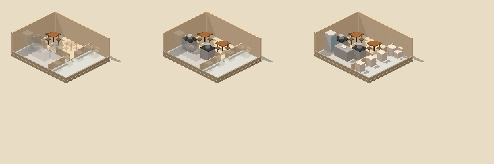
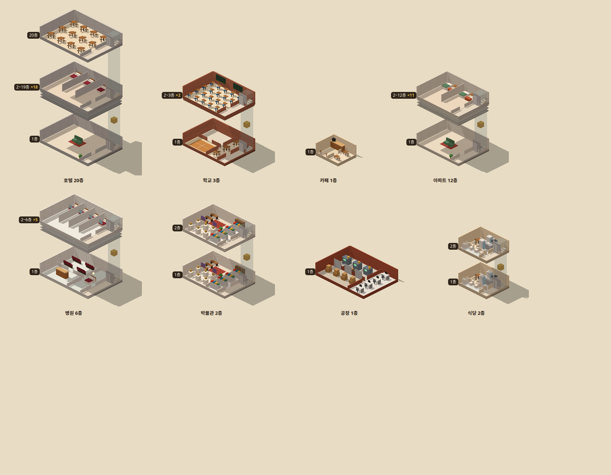

# promptshop

**A social tycoon on shared islands. Write one line, and Claude builds your shop; then you furnish it and watch the guests inside.**


Each building above came from one line, for example *“a wide exhibition hall showing the gloves and belts of past champions”* or *“a small fish-shaped-bread stall in a winter alley”*. The model chooses the size, the number of floors, wings, roof and front from the description.

## Why specs, not images

Image models draw a nice picture, but every picture comes out at a slightly different angle, scale and light. Put two of them side by side and the town looks wrong.

promptshop splits the work:

- **The LLM writes a spec**: building type, style, roof, colors, sign, floors and their zones. This is short text, and language models are good at it.
- **The renderer owns the look**: an orthographic isometric camera (yaw 45°, pitch 30°, so floor tiles are exactly 2:1), one fixed sun, hard shadows, outlines and nearest-neighbour pixels.

Every shop, from anyone, fits on the same map. The exterior and the interior come from one spec, so the inside inherits the outside's palette and reads as the same shop.

## Run it

No build step. The dev server serves the folder and stands in for the claude.ai artifact runtime (storage, sign-in and Claude calls):

```bash
node scripts/dev.mjs 5300
# open http://localhost:5300/isles.html
```

Saved islands go to `dev-data/db.json`.

## The game

`isles.html` is an archipelago of ten islands, one per friend. You start on your own island:

- **Build.** Pick a glowing plot, write one line (or tap an example), and Claude streams the building part by part (`src/v2/steps.js`) while it rises from a building site.
- **Guests.** Boats bring guests to each island's pier. They walk to the shops that sell what they want, queue, pay and sail away. More and fuller shops draw bigger boats.
- **Inside.** Tap a shop to open its cross-section in place. Each floor runs its own simulation: guests queue at counters, sit at tables and pay when they finish. Fixtures start as see-through ghosts; buying one fills it in and raises the shop's queue, price and speed. Red steam shows where guests get stuck.
- **Power and water.** Every building, every floor added and every machine put in uses power and water. Each island has a power plant (a post of lamps, one lit per unit used) and a water tank (its level drops as water is used) on the shore by its pier; when they are full, grow them before building more. Power poles carry the cable along the road; a new building stays dark until a light runs along the cable and switches it on. From five buildings on, every building pays its power and water each minute, whatever it earns (an unpaid bill closes the newest buildings until it is paid). Claude builds are limited per day.
- **Grow.** Served guests raise the island's level (bigger plots, more land). Shops can be extended upwards.
- **Festival.** Every few minutes a festival boat brings a crowd larger than your shops can take. Serve enough of them in the window to earn stars and tips.
- **Friends.** Neighbouring islands are joined by bridges that both owners pay half of; residents cross and spend in each other's shops. The world map lists every archipelago.




## Cross-sections

Inside, a building is a stack of floors. Each kind of floor is written once over a range of levels, zones are laid out by a squarified treemap, and each zone brings its own furniture (`src/v2/interior.js`).



## Quality loop

`src/v2/check.js` repairs a model answer before it is drawn: unknown names snap to the nearest known type, style, roof, zone, fixture, icon or prop; missing floors are joined to their neighbours; a missing name comes from the description. Only what it cannot fix goes back to the model in one short follow-up. `tests/check.html` runs the checker on a deliberately broken answer.

## Code

See [docs/ARCHITECTURE.md](docs/ARCHITECTURE.md) for the layers and the checks (`node scripts/check-isles.mjs`). Plans are in [docs/ROADMAP.md](docs/ROADMAP.md) and the research behind them in [docs/RESEARCH.md](docs/RESEARCH.md).

## License

MIT
