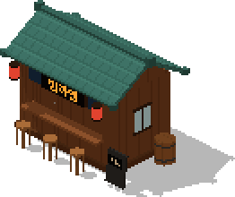
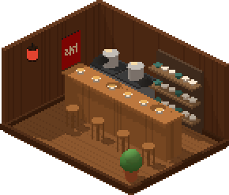
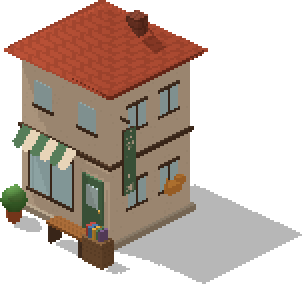
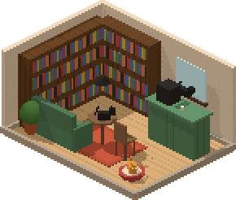
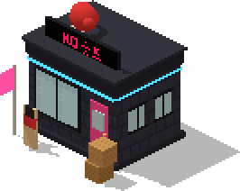
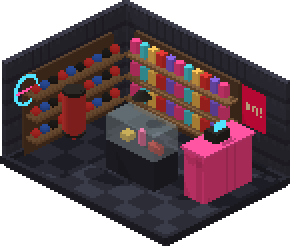

# promptshop

**One line of text → a shop spec (JSON) → a pixel-art isometric shop, outside and inside.**

| “A teal-tiled ramen stall that only opens at night” | |
| --- | --- |
|  |  |
| **“A tiny two-floor book café run by a cat”** | |
|  |  |
| **“A fight-merch shop with a flashing neon sign”** | |
|  |  |

## Why specs, not images

Image models draw a nice picture, but every picture comes out at a slightly different angle, scale and light. Put two of them side by side and the town looks wrong.

promptshop splits the work:

- **The LLM writes a spec**: roof type, wall material, colors, sign, props, furniture layout. This is short JSON, and language models are good at it.
- **The renderer owns the look**: an orthographic isometric camera (yaw 45°, pitch 30°, so floor tiles are exactly 2:1), one tile = 40 px wide, one fixed sun, hard shadows, nearest-neighbor textures.

The result is that every shop, from anyone, fits in the same town. Specs are also small, cheap to generate, easy to edit ("make the roof red" changes one field), and can carry game data. A spec that says four stools can also mean four seats.

The exterior and the interior come from one spec, so the inside inherits the outside's palette and materials and reads as the same shop.

## Run it

No build step. Serve the folder and open `index.html`:

```bash
python3 -m http.server 8000
# open http://localhost:8000/
```

The page renders the example shops and has a box where you can edit a spec and render it.

To export PNGs with headless Chrome:

```bash
scripts/render.sh            # writes out/<id>-ext.png and out/<id>-int.png
```

## Use it

```js
import { renderShop } from './src/render.js';
const canvas = renderShop(spec, 'ext');   // or 'int'
document.body.append(canvas);
```

`three` is loaded through an import map (`three@0.160.0`).

## The spec

See [SPEC.md](SPEC.md) for every field. A minimal exterior:

```json
{
  "size": [2.6, 1.6], "floors": 1,
  "wall": { "mat": "plank", "color": "#7a4a2a" },
  "roof": { "type": "gable", "color": "#3f7a74", "curl": true },
  "front": { "type": "counter" },
  "sign": { "text": "밤라멘", "place": "front", "bg": "#2a1d14", "fg": "#ffd27a", "glow": true },
  "props": [ { "type": "lantern", "x": -1.15, "color": "#e2432f" }, { "type": "stool", "x": 0 } ]
}
```

To generate specs with an LLM, give it [SPEC.md](SPEC.md) and a one-line description, and ask for JSON only. Unknown fields are ignored and unknown prop types are skipped, so a slightly wrong answer still renders.

## Status

This is an early prototype. Known limits:

- Sign text is unreadable at this pixel size. Show the shop name as a label outside the picture.
- The part library is small: 4 roof types, 3 fronts, about 25 props and furniture pieces. Quality grows with the library.
- There is no outline or palette-reduction pass yet.

Contributions of new parts are welcome. Keep the camera, the light and the tile size unchanged.

## License

MIT
